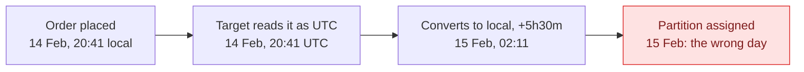
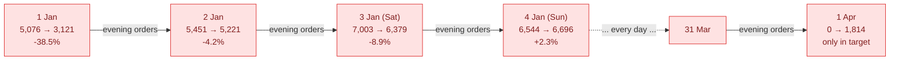
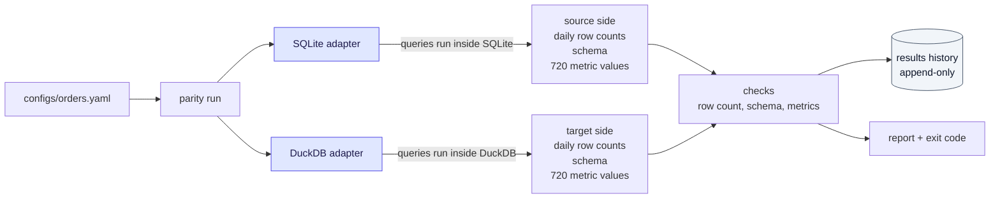
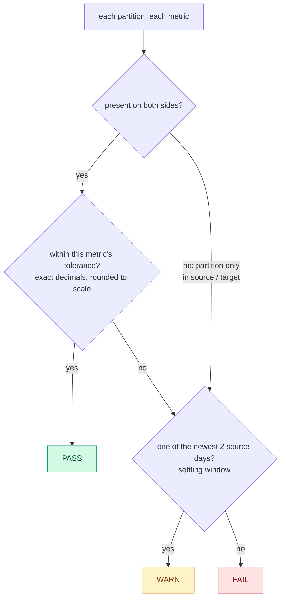

# parity-check

**Proves two database engines return the same answers, partition by partition, and shows you where they don't.**

During a warehouse migration, the old and new systems run side by side for weeks. Before anything cuts over, someone has to prove the new one returns the same answers as the old one.

The check most people write first, a total row count, is close to useless here. The most common defects move rows to the wrong day instead of losing them, so the totals match while the daily numbers are wrong.

parity-check compares two engines day by day on row counts, schema and business metrics, keeps a history of every run, and exits with a code your scheduler or CI can act on.

> **Status:** checks, run history and the `run` command are working. Next: a row-level drill-down that finds the exact rows behind each failure.

---

## What it catches

The demo ships with a bug seeded on purpose. The target pipeline reads naive local timestamps as UTC and shifts them by +5h30m before deriving the date. Every order from 18:30 onward lands on the next day. No row is lost.

| | Source (SQLite) | Target (DuckDB) |
| --- | --- | --- |
| Total rows | 483,085 | 483,085 |
| Total revenue | 24,391,784.03 | 24,391,784.03 |
| Days that match | 90 of 90 | **0 of 91** |

Totals match to the cent. Every single day is wrong, and a day appears that the source never had.



Each day loses its own late evening and gains the previous day's, so the error goes both ways:



---

## Run it

Requires Python 3.10+. No cloud accounts, no database server: both engines run inside Python.

```bash
git clone https://github.com/rohanchimne/parity-check.git
cd parity-check
python -m venv .venv && source .venv/bin/activate
pip install -r requirements.txt && pip install -e .
make demo
```

`make demo` generates 483,085 synthetic orders, runs the checks on clean data, injects the timezone bug, runs again, then restores clean data.

**Clean data**

```
parity-check  dataset=orders  run=9847e874bc31
source: sqlite  data/source.db
target: duckdb  data/target.db

row_count     90 pass     0 warn      0 fail
schema         8 pass     0 warn      0 fail
metric       720 pass     0 warn      0 fail

RESULT: PASS  (0 failed checks)
```

**With the timezone bug**

```
row_count      0 pass     2 warn     89 fail
schema         8 pass     0 warn      0 fail
metric        26 pass    16 warn    686 fail

first 10 of 793 problems:
  FAIL  row_count 2026-01-01  row_count     -1,955 rows (-38.5%)
  FAIL  row_count 2026-01-02  row_count     -230 rows (-4.2%)
  FAIL  row_count 2026-01-03  row_count     -624 rows (-8.9%)
  FAIL  row_count 2026-01-04  row_count     +152 rows (+2.3%)
  FAIL  row_count 2026-01-05  row_count     +1,018 rows (+25.1%)
  ...

RESULT: FAIL  (775 failed checks)
```

Run a single dataset yourself:

```bash
python scripts/generate_data.py --inject timezone
python -m parity run configs/orders.yaml
echo $?        # 1: checks failed
```

---

## How it works



1. **A YAML config describes the dataset:** both engines, the partition column, the metrics and each metric's tolerance.
2. **Each engine does its own counting.** Row counts, the schema and 720 metric values per side are computed inside each database. 483,085 rows never leave the engines.
3. **Three checks compare the sides,** per partition: row counts, schema against a type map, and business metrics.
4. **Every result is appended to a history table,** and the run exits `0`, `1` or `2`.

Engine differences live behind one adapter class per engine, each implementing the same four methods. Adding an engine means writing one class.

### How each result is decided



### The checks

| Check | Compares | Catches | Tolerance |
| --- | --- | --- | --- |
| Row count | rows per partition | missing, duplicated or wrong-day rows | exact |
| Schema | columns, types via a type map, nullability | dropped columns, money stored as float | exact |
| Metrics | revenue, order count, distinct customers, average order value by region | transform errors, bad joins | exact to the cent for money, 0.1% for distinct counts and averages |

### Exit codes

| Code | Meaning |
| --- | --- |
| `0` | no failed checks |
| `1` | at least one check failed |
| `2` | could not run: bad config, missing database, wrong command |

---

## Design decisions

Each decision has a cost. Here is what each one buys and what it costs.

| Decision | Why | Tradeoff |
| --- | --- | --- |
| **Per partition, never a single total** | Defects that move rows cancel out in totals. With the seeded bug, totals match exactly while all 91 days fail. | More results to store and read. |
| **Aggregate inside each engine** | Only small result sets move. At real scale this is the difference between a daily check and one nobody runs twice. | Query cost lands on the source system. |
| **Tolerance per metric, exact on money** | Money off by a cent is a bug; a distinct count can drift legitimately. | More config per dataset. |
| **Never compare floats** | SQLite returns revenue as a float, DuckDB as an exact decimal. On clean data, a plain `==` raised **91 false alarms**: 89 revenue days and 2 averages summed in a different order. Every value is converted to a decimal and rounded to its scale first. | Every metric that isn't a whole number needs a `scale` in its config. |
| **Settling window** | The newest days may still receive late data. Without a window, they alert every morning and people stop reading alerts. | Real failures on the newest 2 days show as warnings until they age out. |
| **Append-only run history** | A cutover decision needs a trend and an evidence trail, not just today's state. | The history only grows. |
| **Values stored as text in history** | The value column mixes ints, floats and decimals; a numeric column would silently convert some. | Values must be parsed back to compare them later. |

### What the averages taught

Under the seeded bug, order counts and revenue failed on every day, but **25 of 455 region-day averages still passed**. In the generated data, an order's value doesn't depend on its hour, so moving orders between days changes how many there are, not how big. Averages are weak detectors for this class of bug, which is why the config checks several metrics, not one.

---

## Project layout

```
configs/
  orders.yaml                  the dataset: engines, partition column, metrics, tolerances
  type_maps/sqlite_to_duckdb.yaml   acceptable type changes between engines
scripts/
  generate_data.py             seeded synthetic orders; --inject timezone seeds the bug
src/parity/
  cli.py                       python -m parity run <config>
  runner.py                    runs every check for one dataset
  config.py                    loads and validates configs with readable errors
  profile.py                   builds aggregate SQL from config
  checks.py                    row count, schema and metric checks
  results.py                   append-only run history
  adapters/                    one class per engine, four methods each
tests/                         43 tests, including the clean and bugged cases end to end
```

---

## Roadmap

- [x] Seeded synthetic data with a timezone bug that keeps totals identical
- [x] Config, engine adapters, aggregation pushed into each engine
- [x] Row count, schema and metric checks with per-metric tolerance
- [x] Run history, report and exit codes
- [ ] **Drill-down:** hash every row of a failed partition on both sides, list missing, extra and changed rows, and report the time window they fall in
- [ ] Cutover gate: ready only after 3 consecutive clean runs
- [ ] Onboard a second dataset with config only
- [ ] CI

---

## What this is not

Not a replacement for Great Expectations, Soda or dbt tests, which validate data within one system. Not data-diff either, which answers "which rows differ?". parity-check answers "is it safe to cut over?": per-partition checks across two engines, per-metric tolerance, run history and, next, a drill-down that points at the cause.

## License

MIT
